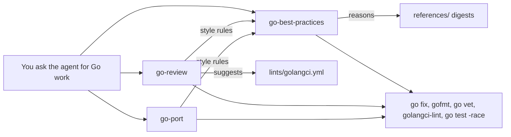
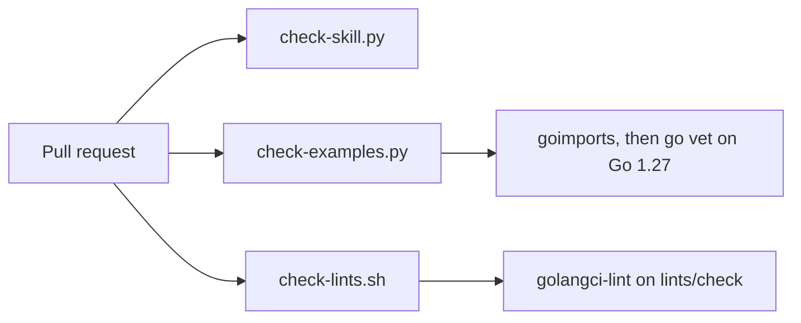

# Beautiful Go

Beautiful Go is a set of three [Agent Skills](https://agentskills.io) and a golangci-lint
configuration that teach coding agents to write, review, and port Go the way Go 1.27 code
is written in November 2026. The skills work with any agent that reads the Agent Skills
format, e.g. Claude Code, OpenAI Codex, Cursor, and Gemini CLI.

- `go-best-practices` loads when an agent writes or changes Go code.
- `go-review` reviews a file, package, or diff, and writes a report in which every
  finding cites a rule and shows the fix.
- `go-port` ports C, C++, Python, Java, JavaScript, TypeScript, Rust, or older Go into Go
  with the same behavior, and ports the original tests first.
- `lints/golangci.yml` enforces the rules that a linter can check.

The project follows the same design as
[Beautiful Rust](https://github.com/morganlinton/BeautifulRust), which does the same job
for Rust.

## What is in the repository

```text
skills/
├── go-best-practices/
│   ├── SKILL.md              # the rules the agent follows when it writes Go
│   └── references/           # one digest per source, read when a rule needs its reason
├── go-review/
│   ├── SKILL.md              # review order, severity levels, and report rules
│   └── assets/review-template.md
└── go-port/
    └── SKILL.md              # mapping tables per source language, and porting notes
lints/
├── golangci.yml              # golangci-lint v2 configuration
└── check/violations.go       # one known violation per linter, used to test the configuration
scripts/                      # the checks that CI runs on every pull request
```

## How the skills work together

The review skill and the port skill don't repeat the style rules. Both send the agent to
`go-best-practices` for style, and the review skill points to the lint configuration for
the checks that a linter can do.



## What the skills change in Go code

The following diff shows the kind of change the rules ask for. It is an example, written
by hand, of a function an agent might produce from older Go habits, and of the same
function after the skill's rules. It does not show the results of a measured test run.

```diff
-func FetchAll(urls []string) map[string][]byte {
-	results := map[string][]byte{}
-	var mu sync.Mutex
-	var wg sync.WaitGroup
-	for _, u := range urls {
-		wg.Add(1)
-		go func(u string) {
-			defer wg.Done()
-			resp, err := http.Get(u)
-			if err != nil {
-				log.Printf("Failed to fetch %s: %v", u, err)
-				return
-			}
-			body, _ := ioutil.ReadAll(resp.Body)
-			mu.Lock()
-			results[u] = body
-			mu.Unlock()
-		}(u)
-	}
-	wg.Wait()
-	return results
-}
+func FetchAll(ctx context.Context, urls []string) ([][]byte, error) {
+	g, ctx := errgroup.WithContext(ctx)
+	g.SetLimit(8)
+	bodies := make([][]byte, len(urls))
+	for i, u := range urls {
+		g.Go(func() error {
+			b, err := fetch(ctx, u)
+			if err != nil {
+				return fmt.Errorf("fetch %s: %w", u, err)
+			}
+			bodies[i] = b
+			return nil
+		})
+	}
+	return bodies, g.Wait()
+}
```

The old version has several problems that the rules address.

- The caller can't cancel the requests, because the function takes no context. The
  skill puts `ctx` first in every function that blocks.
- The function logs errors and drops them, and it ignores the read error. The skill says
  to return each error once, with context, and `errcheck` catches the ignored error.
- The response body is never closed, and `bodyclose` and `noctx` report the `http.Get`
  call.
- The function starts one goroutine per URL with no limit. The skill starts goroutines
  with `errgroup` or `wg.Go`, so the caller always waits, and `SetLimit` bounds them.

## Which Go releases the skills cover

The skills tell the agent to read the `go` line in `go.mod` first, and then to use the
newest features that the line allows. The table lists the main features by release.

| Go release | Features the skills use |
|---|---|
| 1.21 to 1.23 | `min`, `max`, `clear`, `slices`, `maps`, `log/slog`, one loop variable per iteration, `range` over integers and iterators |
| 1.24 | `t.Context()`, `b.Loop()`, `os.Root`, the `omitzero` JSON option, `tool` lines in `go.mod` |
| 1.25 | `sync.WaitGroup.Go`, `testing/synctest`, `http.CrossOriginProtection` |
| 1.26 | `new(expr)`, `errors.AsType`, and the modernizers in `go fix` |
| 1.27 | generic methods, `encoding/json/v2`, the `uuid` package, and the `goroutineleak` profile |

The file `skills/go-best-practices/references/modern-go.md` lists each release in full.

## Install the skills

Each skill is a folder under `skills/`. Install all three, because the review skill and
the port skill depend on `go-best-practices`.

The [`skills`](https://github.com/vercel-labs/skills) installer works with most agents.

```bash
npx skills add bjoernaagaard/BeautifulGo
```

Add `-g` to install the skills for your user account instead of the current project.

To install the skills by hand, copy or link the three folders into the folder where your
agent looks for skills, e.g. `~/.claude/skills/` for Claude Code or `~/.agents/skills/`
for agents that use the shared location.

```bash
git clone https://github.com/bjoernaagaard/BeautifulGo
ln -s "$PWD/BeautifulGo/skills/go-best-practices" ~/.agents/skills/
ln -s "$PWD/BeautifulGo/skills/go-review" ~/.agents/skills/
ln -s "$PWD/BeautifulGo/skills/go-port" ~/.agents/skills/
```

You rarely need to call the skills by name, because the agent loads them when a task
mentions Go, a `.go` file, or a Go tool.

## Use the lint configuration

Copy `lints/golangci.yml` to the root of your module as `.golangci.yml`, and run
golangci-lint 2.15 or later.

```bash
cp BeautifulGo/lints/golangci.yml your-module/.golangci.yml
cd your-module && golangci-lint run
```

The configuration enables 33 linters, which fall into these groups:

- bugs and leaks, e.g. `errcheck`, `bodyclose`, `forcetypeassert`, and `govet` with all
  of its analyzers
- errors, context, and concurrency, e.g. `errorlint`, `containedctx`, `contextcheck`, and
  `noctx`
- API shape and modern Go, e.g. `revive`, `iface`, `recvcheck`, `modernize`, and
  `exptostd`
- logging, tests, and security, e.g. `sloglint`, `thelper`, `usetesting`, `gosec`, and
  `nolintlint`, which rejects a `//nolint` comment that has no linter name or no reason

## How the repository checks itself

CI runs three checks on every pull request, and you can run the same checks locally.

```bash
python3 scripts/check-skill.py      # front matter, links, and referenced files exist
python3 scripts/check-examples.py   # every Go example in the skills type-checks
sh scripts/check-lints.sh           # the configuration is valid and reports each fixture violation
```

The example check puts each Go code block in its own package. It then adds imports with
`goimports` and runs `go vet`, so a code example that doesn't compile with Go 1.27 fails
the build. The lint check runs golangci-lint against `lints/check/violations.go` and fails
when one of the expected linters reports nothing.



## Sources

The rules come from these sources, and each has a digest in
`skills/go-best-practices/references/`. Where the sources disagree, the skill picks one
rule and says why.

- [Effective Go](https://go.dev/doc/effective_go) and the
  [Go Code Review Comments](https://go.dev/wiki/CodeReviewComments) wiki
- [Google Go Style Guide](https://google.github.io/styleguide/go/)
- [Uber Go Style Guide](https://github.com/uber-go/guide/blob/master/style.md)
- The [Go release notes](https://go.dev/doc/devel/release) from Go 1.21 to Go 1.27
