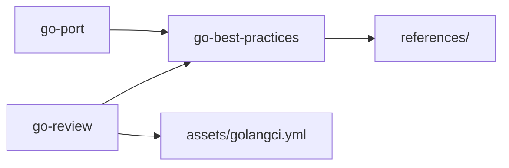

# Beautiful Go

Beautiful Go is a set of three [Agent Skills](https://agentskills.io) and a golangci-lint
configuration that teach coding agents to write, review, and port Go 1.27 code. The
skills work with any agent that reads the Agent Skills format, e.g. Claude Code, Codex,
Cursor, and Gemini CLI.

```text
skills/
├── go-best-practices/   # rules the agent follows when it writes Go
│   └── references/      # digests of the style guides, read when a rule needs its reason
├── go-review/           # writes a review in which every finding cites a rule and shows the fix
│   └── assets/          # the review template and golangci.yml
└── go-port/             # ports C, C++, Python, Java, JS, TS, Rust, or older Go, tests first
scripts/                 # the checks that CI runs
```

The review skill and the port skill take their style rules from `go-best-practices`, so
install all three.



## Install

Install the skills with the [`skills`](https://github.com/vercel-labs/skills) installer,
and add `-g` to install them for your user account instead of the current project.

```bash
npx skills add bjoernaagaard/BeautifulGo
```

To install by hand, copy or link the three folders under `skills/` into the folder where
your agent looks for skills, e.g. `~/.claude/skills/` or `~/.agents/skills/`.

The skills run these tools, and they skip a tool that is missing.

| Tool | Where to get it |
|---|---|
| Go 1.27 | [go.dev/dl](https://go.dev/dl/) |
| golangci-lint 2.15 or later | [golangci-lint.run](https://golangci-lint.run/docs/welcome/install/) |
| govulncheck | `go install golang.org/x/vuln/cmd/govulncheck@latest` |
| jscpd 5.4 or later, optional for `go-port` | [github.com/kucherenko/jscpd](https://github.com/kucherenko/jscpd) |

## Use the lint configuration

The configuration enables 33 linters and the `gofmt` and `goimports` formatters. Copy it
to the root of your module.

```bash
cp skills/go-review/assets/golangci.yml your-module/.golangci.yml
cd your-module && golangci-lint run
```

## Check the repository

CI runs these checks on every pull request. The checks need Go 1.27, golangci-lint,
Python 3.11 or later, and network access, because check-examples.py runs go get.

```bash
python3 scripts/check-skill.py      # front matter, links, and referenced files
python3 scripts/check-examples.py   # every Go example is gofmt-clean and passes go vet
sh scripts/check-lints.sh           # every enabled linter fires on scripts/lint-fixture
python3 scripts/check-versions.py   # every version agrees with versions.toml
python3 scripts/check-rules.py      # the rule table is well formed, its ids match scripts/rule-ids.txt, and its tools exist
```

A weekly scheduled run, `.github/workflows/upstream.yml`, compares `versions.toml` with
the newest Go release, golangci-lint release and upstream guides, and fails naming what
moved. Run `python3 scripts/check-versions.py --upstream` to see the same report.

## Sources

The rules come from [Effective Go](https://go.dev/doc/effective_go), the
[Go Code Review Comments](https://go.dev/wiki/CodeReviewComments) wiki, the
[Google](https://google.github.io/styleguide/go/) and
[Uber](https://github.com/uber-go/guide/blob/master/style.md) style guides, and the
[Go release notes](https://go.dev/doc/devel/release). The project follows the design of
[Beautiful Rust](https://github.com/morganlinton/BeautifulRust).
